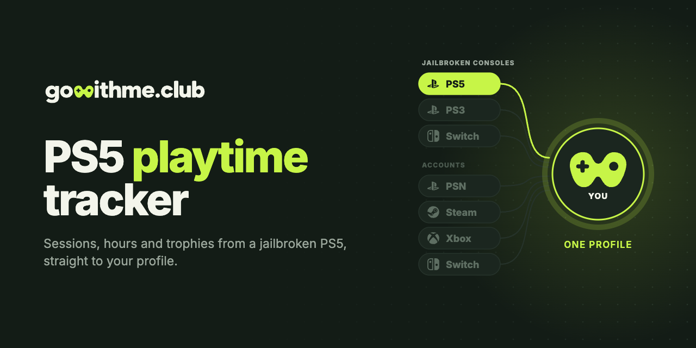

<p align="center">
  <a href="https://gowithme.club"></a>
</p>

<p align="center">
  <b>English</b> · <a href="README.ru.md">Русский</a>
</p>

<p align="center">
  <a href="https://github.com/gowithme-club/ps5-playtime-tracker/releases/latest"></a>
  
  <a href="LICENSE"></a>
</p>

# PS5 Playtime Tracker

An open-source payload that tracks playtime, play sessions and trophies on a
jailbroken PS5, for PS5 and PS4 games, and syncs them to your
[gowithme.club](https://gowithme.club) profile. No PSN account needed.

**Requires:** a jailbroken PS5 with an ELF loader (Payload Manager or elfldr) and a free gowithme.club account.<br>
**Tested on:** PS5 firmware 13.40.

## Features

- Every play session with its start, end and length.
- Trophies for PS5 games, read from the console's trophy files.
- Trophies for PS4 games, read from the console's trophy notifications.
- Sessions played while the payload was stopped, recovered from the system journal.
- Live “playing now” status on your profile while the payload runs.
- Reports queue on the console while it is offline.

## Install

1. Download `gowithme.club_v<version>.elf` from the
   [latest release](https://github.com/gowithme-club/ps5-playtime-tracker/releases/latest).
2. Load it with Payload Manager, or send it to elfldr on port 9021.
   The console shows a six-digit code.
3. On gowithme.club open **Settings → PS5 (CFW)** and enter the code.

No config file is needed.

## FAQ

**How do I track playtime on a jailbroken PS5?**
Run this payload and link it to a gowithme.club profile with the on-screen code.
Sessions, hours and trophies then show up on the profile.

**Do I need a PSN account?**
No. The payload reads activity on the console and sends it to gowithme.club directly.

**Does it jailbreak the console?**
No. It needs a console that is already jailbroken and can load ELF payloads.

**Does it have to run all the time?**
No. Sessions stay in the system journal and are picked up on the next start.
PS4 trophy notifications disappear after a while, so run the payload
regularly if you play PS4 games.

**Does it survive a reboot?**
No. Load it again after each jailbreak, or add it to your loader's autoload.

**Does it work offline?**
Yes. Reports wait in a queue on the console and go out once it is online.

**What does it send?**
The game's title ID and name, session times, unlocked trophies, the console
profile name and the console's name from its settings.

**How do I remove it?**
Stop loading the payload and delete `/data/gowithme.club` on the console.
To unlink the console, remove it in your gowithme.club settings.

## Build from source

```bash
brew install llvm@18
curl -LO https://github.com/ps5-payload-dev/sdk/releases/latest/download/ps5-payload-sdk.zip
unzip ps5-payload-sdk.zip -d ~
make          # dist/gowithme.club_v<version>.elf
make test     # host tests, no console needed
```

## Other consoles

| Console | Repository | Runs as |
| --- | --- | --- |
| PS5, jailbroken | **ps5-playtime-tracker** | payload |
| PS3 on HEN or CFW | [ps3-playtime-tracker](https://github.com/gowithme-club/ps3-playtime-tracker) | VSH plugin |
| Switch with Atmosphere | [switch-playtime-tracker](https://github.com/gowithme-club/switch-playtime-tracker) | sysmodule |

Stock PS4 and PS5, Steam, Xbox, Nintendo Switch and Discord connect on
[gowithme.club](https://gowithme.club) without installing anything.

## Support

[Telegram support](https://t.me/gowithme_club_support) ·
[GitHub issues](https://github.com/gowithme-club/ps5-playtime-tracker/issues) ·
pull requests are welcome.

## License

[MIT](LICENSE). SQLite is bundled under its public-domain dedication.

Unofficial homebrew, not affiliated with or endorsed by Sony Interactive
Entertainment. PlayStation and PS5 are trademarks of their respective owners.
