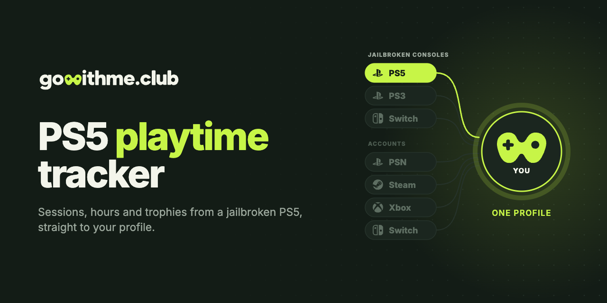

<p align="center">
  <a href="https://gowithme.club"></a>
</p>

<p align="center">
  <a href="README.md">English</a> · <b>Русский</b>
</p>

<p align="center">
  <a href="https://github.com/gowithme-club/ps5-playtime-tracker/releases/latest"></a>
  
  <a href="LICENSE"></a>
</p>

# Трекер игрового времени для PS5

Пейлоад с открытым кодом: считает игровое время, сессии и трофеи на PS5 с
джейлбрейком — в играх PS5 и PS4 — и отправляет их в ваш профиль на
[gowithme.club](https://gowithme.club). Аккаунт PSN не нужен.

**Нужно:** PS5 с джейлбрейком и загрузчиком ELF (Payload Manager или elfldr) и бесплатный аккаунт gowithme.club.<br>
**Проверено:** PS5 на прошивке 13.40.

## Возможности

- Каждая сессия с началом, концом и длительностью.
- Трофеи игр PS5 — из файлов трофеев на консоли.
- Трофеи игр PS4 — из уведомлений о трофеях.
- Сессии, сыгранные без пейлоада, — из системного журнала.
- Статус «сейчас играет» в профиле, пока пейлоад запущен.
- Без сети отчёты копятся на консоли.

## Установка

1. Скачайте `gowithme.club_v<версия>.elf` из
   [последнего релиза](https://github.com/gowithme-club/ps5-playtime-tracker/releases/latest).
2. Запустите его через Payload Manager или отправьте в elfldr на порт 9021.
   На консоли появится шестизначный код.
3. На gowithme.club откройте **Настройки → PS5 (CFW)** и введите код.

Конфиг писать не нужно. Уведомления на консоли — на английском.

## Вопросы

**Как считать игровое время на PS5 с джейлбрейком?**
Запустите этот пейлоад и привяжите консоль к профилю gowithme.club кодом с
экрана. Сессии, часы и трофеи появятся в профиле.

**Нужен ли аккаунт PSN?**
Нет. Пейлоад читает активность на консоли и отправляет её на gowithme.club напрямую.

**Пейлоад взламывает консоль?**
Нет. Нужна консоль, которая уже взломана и умеет загружать ELF-пейлоады.

**Его нужно держать запущенным постоянно?**
Нет. Сессии остаются в системном журнале и подтянутся при следующем запуске.
Уведомления о трофеях PS4 со временем исчезают, поэтому, если играете в игры
PS4, запускайте пейлоад регулярно.

**Он переживает перезагрузку?**
Нет. Запускайте его после каждого джейлбрейка или добавьте в автозагрузку
своего загрузчика.

**Работает без интернета?**
Да. Отчёты ждут в очереди на консоли и уходят, когда она выйдет в сеть.

**Что он отправляет?**
Title ID и название игры, время сессий, выбитые трофеи, имя профиля и название
консоли из её настроек.

**Как удалить?**
Перестаньте запускать пейлоад и удалите на консоли папку `/data/gowithme.club`.
Чтобы отвязать консоль, удалите её в настройках gowithme.club.

## Сборка из исходников

```bash
brew install llvm@18
curl -LO https://github.com/ps5-payload-dev/sdk/releases/latest/download/ps5-payload-sdk.zip
unzip ps5-payload-sdk.zip -d ~
make          # dist/gowithme.club_v<версия>.elf
make test     # тесты на компьютере, консоль не нужна
```

## Другие консоли

| Консоль | Репозиторий | Что ставится |
| --- | --- | --- |
| PS5 с джейлбрейком | **ps5-playtime-tracker** | пейлоад |
| PS3 с HEN или CFW | [ps3-playtime-tracker](https://github.com/gowithme-club/ps3-playtime-tracker) | VSH-плагин |
| Switch с Atmosphere | [switch-playtime-tracker](https://github.com/gowithme-club/switch-playtime-tracker) | sysmodule |

Обычные PS4 и PS5, Steam, Xbox, Nintendo Switch и Discord подключаются на
[gowithme.club](https://gowithme.club) без установки чего-либо.

## Поддержка

[Поддержка в Telegram](https://t.me/gowithme_club_support) ·
[issues на GitHub](https://github.com/gowithme-club/ps5-playtime-tracker/issues) ·
пулреквесты приветствуются.

## Лицензия

[MIT](LICENSE). SQLite встроен на условиях public domain.

Неофициальный homebrew, не связан с Sony Interactive Entertainment и не одобрен
ею. PlayStation и PS5 — товарные знаки своих владельцев.
